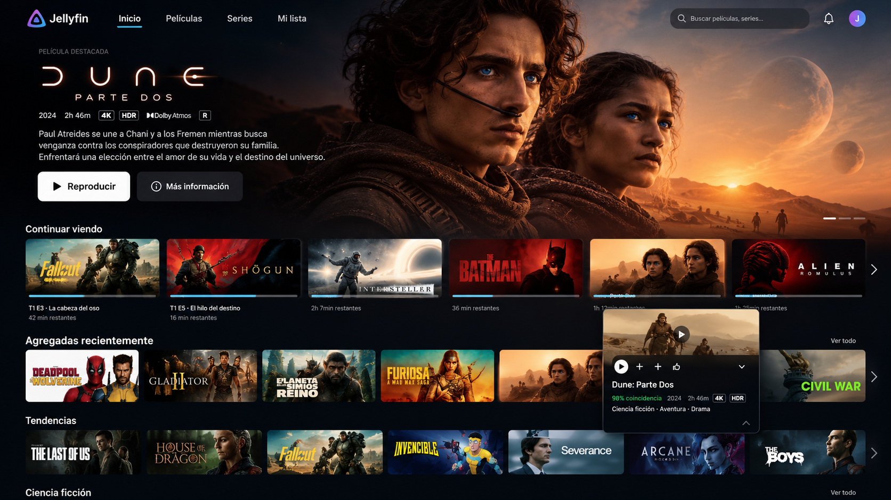

# Jellyfin Cinema Web

Cliente web para explorar y reproducir una biblioteca de películas y series alojada en Jellyfin. Construido con React, TypeScript y Vite, con una interfaz en español y un reproductor integrado.


<!--  -->

## Funcionalidades

- Inicio de sesión con un usuario de Jellyfin y persistencia de la sesión en el navegador.
- Inicio con películas, series, contenido agregado recientemente y una sección para continuar viendo.
- Fichas con imágenes, sinopsis y datos del contenido.
- Navegación por temporadas y episodios.
- Reproducción directa o mediante HLS, según Jellyfin y las capacidades del navegador.
- Selección de pistas de audio y subtítulos, con ajuste del tamaño de los subtítulos.
- Controles de reproducción, volumen, avance y retroceso, y pantalla completa.
- Previsualizaciones en la barra de progreso cuando Jellyfin dispone de imágenes Trickplay.
- Reporte de inicio, progreso y fin de reproducción al servidor.

## Tecnologías

| Tecnología | Uso |
| --- | --- |
| React 19 y TypeScript | Interfaz y tipado |
| Vite 8 | Desarrollo y compilación |
| Tailwind CSS 4 | Estilos |
| React Router 7 | Navegación y rutas protegidas |
| Jellyfin SDK | Autenticación, biblioteca y reproducción |
| hls.js | Reproducción de streams HLS |
| Lucide React | Iconos |
| ESLint | Análisis estático del código |

Las dependencias se encuentran en [package.json](./package.json); `package-lock.json` registra las versiones resueltas.

## Requisitos

- Node.js **20.19 o superior dentro de la rama 20**, o **22.12 o superior**, según el requisito de Vite instalado.
- npm.
- Un servidor Jellyfin accesible desde el navegador, con bibliotecas configuradas y una cuenta con permiso de reproducción.

El proyecto contiene el frontend. El servidor Jellyfin se instala y administra por separado.

## Instalación y configuración

1. Clona el repositorio y entra en su carpeta. Sustituye `TU_USUARIO` por el propietario del repositorio; el comando asume el nombre sugerido:

   ```bash
   git clone https://github.com/TU_USUARIO/jellyfin-cinema-web.git
   cd jellyfin-cinema-web
   ```

2. Instala las dependencias del archivo de bloqueo:

   ```bash
   npm ci
   ```

3. Crea un archivo **`.env.local`** en la raíz, junto a `package.json`:

   ```dotenv
   VITE_JELLYFIN_URL=http://localhost:8096
   ```

   Reemplaza la dirección por la URL base de tu servidor Jellyfin. `localhost` sirve si el servidor está en el mismo equipo que el navegador; para otro equipo, usa su dirección de red o dominio. Si Jellyfin se publica bajo una subruta, inclúyela en la URL base.

   Esta variable es obligatoria. También puede leerse desde `.env`; si ya existe, revisa su configuración. `.env.local` está excluido de Git por la regla `*.local` del proyecto. Las variables con prefijo `VITE_` forman parte del frontend compilado: no coloques contraseñas ni tokens en ellas.

4. Inicia el servidor de desarrollo:

   ```bash
   npm run dev
   ```

5. Abre la URL que indique Vite en la terminal e inicia sesión con tus credenciales de Jellyfin.

Después de cambiar la variable de entorno, reinicia Vite. Para una publicación, vuelve a compilar.

## Comandos

| Comando | Descripción |
| --- | --- |
| `npm ci` | Instala las dependencias a partir de `package-lock.json` |
| `npm run dev` | Inicia Vite en modo desarrollo |
| `npm run build` | Comprueba TypeScript y genera la aplicación en `dist/` |
| `npm run preview` | Sirve localmente la compilación para revisarla |
| `npm run lint` | Ejecuta ESLint |

Actualmente no hay un comando de pruebas automatizadas definido en `package.json`.

## Uso y rutas

| Ruta | Pantalla |
| --- | --- |
| `/login` | Inicio de sesión |
| `/` | Biblioteca principal |
| `/peliculas` | Películas |
| `/series` | Series |
| `/watch/:itemId` | Reproductor del elemento seleccionado |

Las pantallas de biblioteca y reproducción requieren una sesión. Las rutas desconocidas redirigen al inicio.

Durante la reproducción puedes usar estos atajos:

| Tecla | Acción |
| --- | --- |
| Espacio | Reproducir o pausar |
| Flecha izquierda | Retroceder 10 segundos |
| Flecha derecha | Avanzar 10 segundos |
| `M` | Activar o desactivar el sonido |
| `F` | Alternar pantalla completa |

## Estructura del proyecto

```text
public/                  Recursos estáticos
src/
  assets/                Imágenes y recursos de la interfaz
  components/            Navegación, catálogo, detalles y reproductor
  context/               Estado de autenticación, detalles y reproducción
  hooks/                 Carga de datos del inicio, series y fichas
  pages/                 Inicio, login, películas, series y reproducción
  routes/                Rutas y protección de acceso
  services/jellyfin/     Cliente SDK, autenticación, biblioteca, imágenes y streaming
  types/                 Tipos de contenido y reproducción
  utils/                 Utilidades de tiempo
  App.tsx                Componente raíz
  main.tsx               Inicialización y proveedores de contexto
```

La interfaz obtiene los datos mediante los servicios de Jellyfin. Los contextos mantienen la sesión y el estado de la aplicación; el reproductor solicita la información de streaming y reporta el progreso al servidor.

## Compilación y publicación

```bash
npm run build
npm run preview
```

Publica el contenido de `dist/` en un alojamiento de archivos estáticos. Configura el servidor para devolver `index.html` en las rutas de la aplicación, como `/series` o `/watch/:itemId`, ya que se utiliza `BrowserRouter`.

La URL de Jellyfin se incorpora durante la compilación y debe ser accesible desde los equipos que visiten la aplicación. Si el frontend se sirve mediante HTTPS, utiliza también HTTPS para Jellyfin para evitar bloqueos por contenido mixto. Si los orígenes son diferentes, revisa la configuración de acceso entre orígenes del servidor o proxy.

## Estado actual y limitaciones

- El buscador, las notificaciones y el botón de perfil de la barra de navegación aún no tienen acciones implementadas.
- El enlace **Mi lista** aparece en la navegación, pero no tiene una pantalla propia. El enlace **Inicio** apunta a `/inicio`, que redirige a `/` mediante la ruta de respaldo.
- Las consultas de biblioteca limitan películas y series a 50 elementos por categoría, y las secciones de continuar viendo y recientes a 20; no hay paginación implementada.
- La compatibilidad de vídeo, audio y subtítulos depende del navegador, del archivo y de la configuración de transcodificación de Jellyfin.
- Las previsualizaciones Trickplay requieren que el servidor tenga los recursos correspondientes.
- La sesión, incluido el token de acceso, se almacena en `localStorage`; la contraseña no se guarda allí. El contexto dispone de una función para cerrar sesión, aunque el botón de perfil aún no está conectado a ella.

## Solución de problemas

| Problema | Qué revisar |
| --- | --- |
| `VITE_JELLYFIN_URL no está configurada` | Define la variable en `.env.local` y reinicia el servidor de desarrollo |
| No se puede iniciar sesión | Comprueba las credenciales y la conectividad; el formulario muestra un mensaje genérico también si falla la conexión |
| No carga la biblioteca | Revisa los permisos del usuario, la URL del servidor y los errores de red en la consola del navegador |
| No se reproduce un archivo | Revisa los códecs, los permisos de transcodificación y los registros de Jellyfin |
| Una ruta falla al recargar en producción | Configura el alojamiento para devolver `index.html` en las rutas del frontend |

